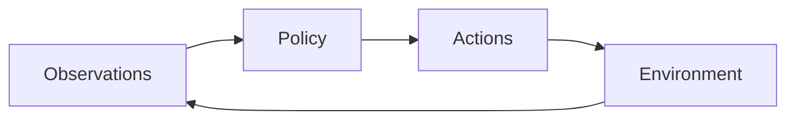

# caiocj1.github.io

Personal academic website for Caio Azevedo, built as a static site for GitHub Pages. Markdown notes are converted to HTML with a small Python script. KaTeX is bundled locally for mathematical typesetting.

## Local preview

One-time setup, from the repository root:

```bash
python3 -m venv .venv
.venv/bin/python -m pip install -r requirements.txt
```

Start the preview (port 8002 avoids the earlier plain HTTP servers):

```bash
.venv/bin/python scripts/preview.py --port 8002
```

Open <http://localhost:8002/notes.html>. New articles appear there after you add Markdown notes.
Save changes in Obsidian; open preview pages rebuild and reload automatically, usually within a second. The server includes drafts and disables browser caching. Automatic reload is injected only by the local preview server, never into generated publication HTML. Stop it with Ctrl+C.

## Writing notes in Obsidian

The `notes/` directory is your vault. Write one `.md` file per article and add these properties at its beginning:

```yaml
---
title: Test note
date: 2026-09-06
description: A first note to try Markdown and mathematical typesetting.
draft: true
---
```

`title`, `date`, and `description` are required. `draft` is a boolean; it defaults to `true` if omitted. Dates use `YYYY-MM-DD`. Use `draft: true` while writing and `draft: false` when the article is ready for a publication build.

The converter preserves your wording and supports headings, lists, emphasis, quotations, fenced code, tables, footnotes, standard Markdown links/images, and `$...$` / `$$...$$` mathematics. The page title comes from the properties, so body headings are shifted down one level. Notes use an 880px maximum reading width; the separate math preview remains 720px wide.

Mermaid diagrams use fenced blocks with the `mermaid` language. They render in both light and dark mode, while an expandable copy of the diagram source remains available below the result:

````markdown

````

Obsidian renders the same syntax in Reading view. Invalid diagrams remain readable as source instead of breaking the rest of the note.

Keep editing the Markdown files. `notes.html` and `notes/**/*.html` are generated; shared markup lives in `templates/notes-page.html`, and appearance lives in `styles.css`. Regeneration also removes obsolete generated pages after a note is renamed, removed, or excluded as a draft. Hand-written article HTML is never overwritten.

Use standard Markdown attachments, for example ``, and keep the referenced image in `notes/attachments/`. Relative image paths remain unchanged because HTML is generated alongside its Markdown source. Links to other `.md` notes are converted to `.html` links. Obsidian `[[wikilinks]]`, `![[embeds]]`, block references, and plugin-specific syntax are not converted; use standard Markdown equivalents for website articles. Raw HTML is displayed as text.

Obsidian's settings, Python's virtual environment, and Finder metadata are ignored by Git.

## Build without starting a server

Local draft build:

```bash
.venv/bin/python scripts/build_notes.py --include-drafts
```

Publication build, excluding draft articles:

```bash
.venv/bin/python scripts/build_notes.py
```

These commands only update local HTML. They do not commit, push, or deploy. Stop the draft preview server before making a publication build; refreshing that server includes drafts again. Existing plain `python3 -m http.server` previews can serve generated HTML, but do not rebuild Markdown when refreshed.

Draft status controls generated HTML and the Notes listing; it does not make Markdown sources private if you later publish the entire repository. Keep private writing outside the published repository.

## Checks

```bash
.venv/bin/python -m unittest discover -s tests -v
```

## Structure

- `index.html` — home and profile
- `publications.html` — publication record
- `notes/` — Obsidian Markdown sources, attachments, and generated article pages
- `notes.html` — generated list of notes
- `templates/notes-page.html` — shared template for the list and articles
- `scripts/build_notes.py` — Markdown converter
- `scripts/preview.py` — local preview with automatic rebuilding/reloading and no browser caching
- `math-preview.html` — typesetting examples with expandable LaTeX source
- `styles.css` — shared visual system and responsive styles
- `assets/` — images, CV, favicon, and bundled KaTeX

The generated site remains plain HTML, CSS, and JavaScript for GitHub Pages.

## Writing mathematics

Open <http://localhost:8002/math-preview.html> directly to see examples. The file is retained but is not linked from the Notes page.

KaTeX 0.18.6 renders mathematics inside each page's `<main>` element. Its scripts, stylesheet, fonts, and MIT license are stored in `assets/vendor/katex/`, so rendering does not depend on a CDN or an internet connection.

Use `\(...\)` for inline equations and `\[...\]` or `$$...$$` for display equations:

```html
<p>A policy \(\pi_\theta(a_t \mid o_t)\) maps observations to actions.</p>

<div>
  \[
    \mathcal{L} = \mathcal{L}_{\mathrm{NTP}} + \lambda\mathcal{L}_{\mathrm{BEV}}
  \]
</div>
```

In Markdown notes, standalone `$$` delimiter lines are treated as display mathematics even when there is no empty line before or after them. A blank line before the opening `$$` gives the equation a bordered panel; placing the opening `$$` directly after the preceding paragraph renders the equation without a border. Dollar delimiters inside fenced code blocks remain literal.

In hand-written HTML, single dollar signs are left alone so ordinary prices are not mistaken for math. In Markdown notes, the converter recognizes `$...$` and converts it into the inline delimiters supported by the renderer; escape a literal dollar sign as `\$` when needed. Expressions inside `<pre>` and `<code>` remain literal. In HTML source, escape `&` as `&amp;` and `<` as `&lt;`, including inside equations. Write LaTeX backslashes directly in HTML; no extra JavaScript escaping is needed.

For a new page, copy these tags into its `<head>` in the same order:

```html
<link rel="stylesheet" href="assets/vendor/katex/katex.min.css">
<link rel="stylesheet" href="styles.css">
<script defer src="assets/vendor/katex/katex.min.js"></script>
<script defer src="assets/vendor/katex/contrib/auto-render.min.js"></script>
<script defer src="assets/math.js"></script>
```

Adjust the asset paths if the page lives in a subdirectory. Math rendering requires JavaScript; without it, the original LaTeX remains visible. See the [KaTeX supported functions](https://katex.org/docs/supported.html) for available notation.
